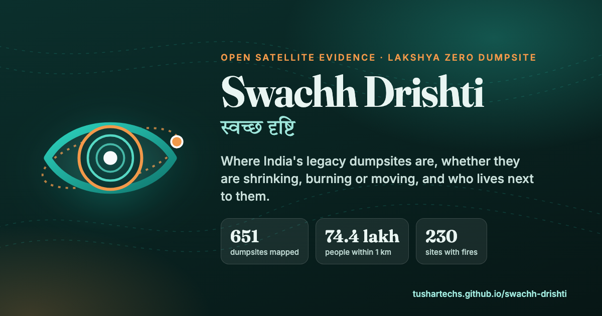
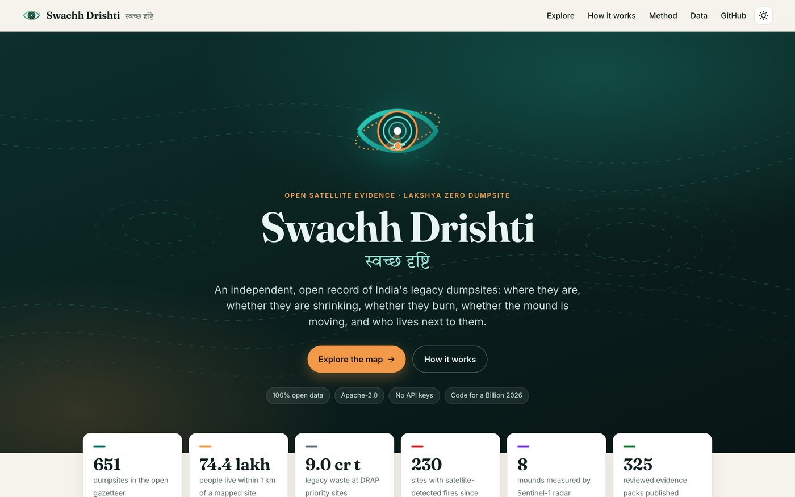
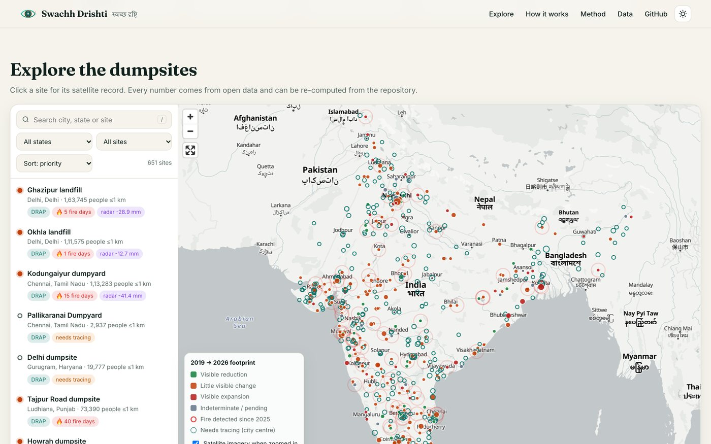
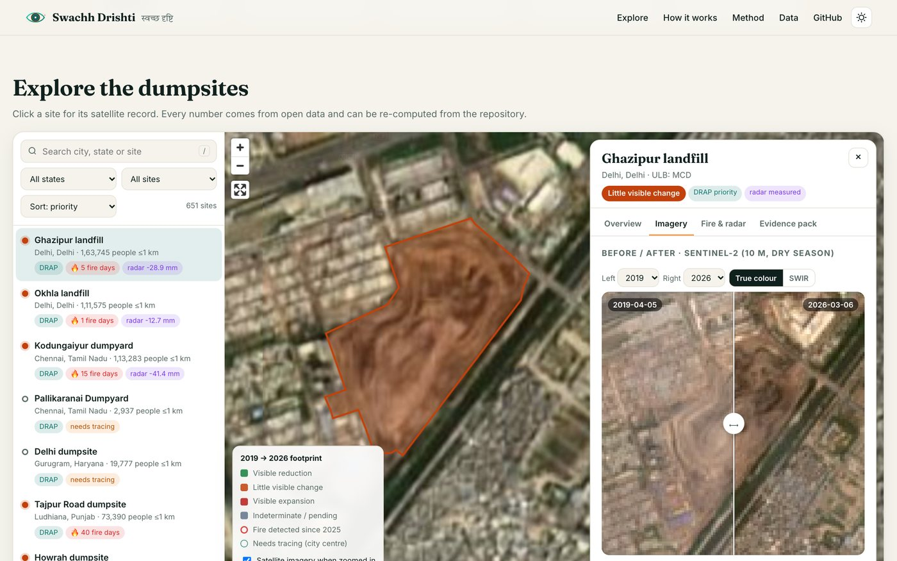
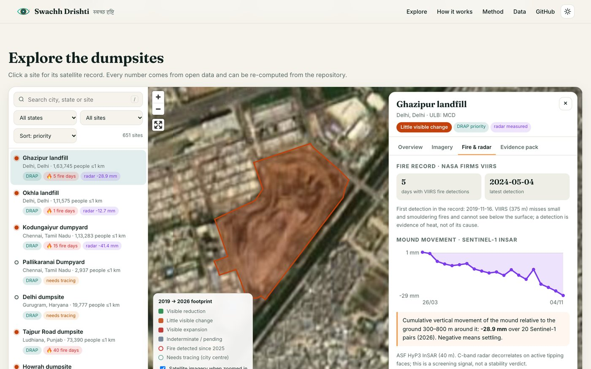
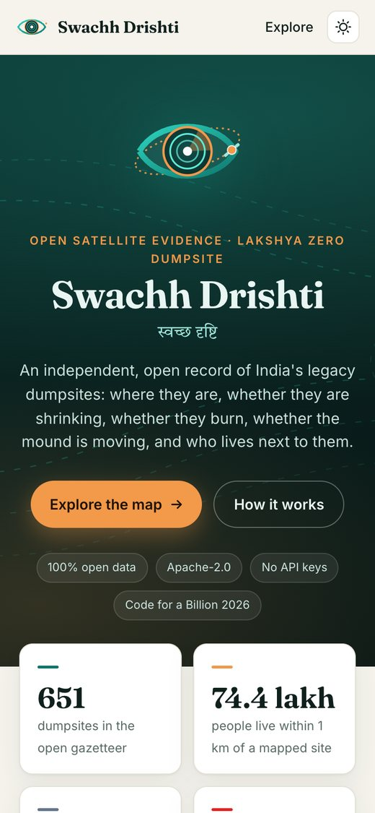
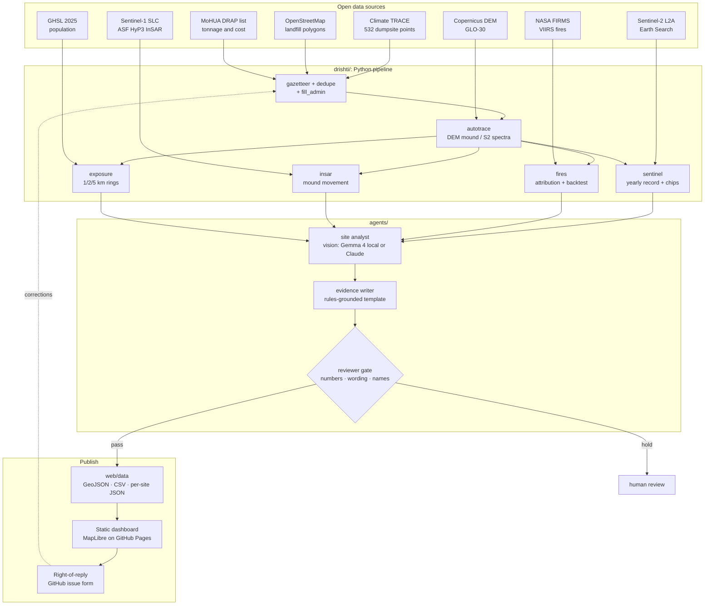

<p align="center">
  
</p>

<h1 align="center">Swachh Drishti <sub>स्वच्छ दृष्टि</sub></h1>

<p align="center">
  <b>Open, independent satellite evidence for India's legacy dumpsites.</b><br>
  Where they are · whether they are shrinking · whether they burn · whether the mound is moving · who lives next to them.
</p>

<p align="center">
  <a href="https://tushartechs.github.io/swachh-drishti/"></a>
  <a href="https://github.com/karlmehta/code-for-a-billion/issues/110"></a>
  <a href="LICENSE"></a>
</p>
<p align="center">
  
  
  
  <a href="https://github.com/TusharTechs/swachh-drishti/actions/workflows/pages.yml"></a>
</p>



---

## For judges: everything in one place

| What | Link | Notes |
|---|---|---|
| **Run it locally** | [Windows / macOS / Linux guide](#run-it-locally-windows-macos-linux) | 2-minute dashboard or full pipeline |
| **Live app** | [tushartechs.github.io/swachh-drishti](https://tushartechs.github.io/swachh-drishti/) | Deployed on GitHub Pages; works on mobile |
| **Example site (Ghazipur, Delhi)** | [Open the site panel](https://tushartechs.github.io/swachh-drishti/#SD0001) | Before/after imagery, fire record, radar movement, evidence pack |
| **Hackathon submission** | [karlmehta/code-for-a-billion#110](https://github.com/karlmehta/code-for-a-billion/issues/110) | Impact area: Waste Management (form category: Climate) |
| **Open data download** | [sites.csv](https://tushartechs.github.io/swachh-drishti/data/sites.csv) · [sites.geojson](https://tushartechs.github.io/swachh-drishti/data/sites.geojson) | 651 sites, one row each |
| **Method & limits** | [web/method.md](web/method.md) | What the satellite evidence can and cannot show |
| **Evaluations** | [docs/evals.md](docs/evals.md) · [docs/backtest_fires.md](docs/backtest_fires.md) | Fire backtest (13/28 detected) and the agent eval, reported honestly |
| **AgentFoundry usage** | [docs/agentfoundry.md](docs/agentfoundry.md) | Evals run in the AF terminal; Smart-Code agent built the CSV download |
| **Right of reply** | [Issue form](https://github.com/TusharTechs/swachh-drishti/issues/new?template=right-of-reply.yml) | ULBs and citizens can correct any site |
| **Licence & attribution** | [LICENSE](LICENSE) · [ATTRIBUTION.md](ATTRIBUTION.md) | Apache-2.0 code; source data licences listed |

### How this maps to the judging rubric

| Criterion (25% each) | Evidence |
|---|---|
| **Size of the problem** | **74.4 lakh people** live within 1 km, and **2.28 crore within 2 km**, of the 325 dumpsites we have outlined (GHSL 2025, each person counted once). About 2,479 legacy dumpsites hold ~25 crore tonnes on ~15,000 acres (PIB, Jan 2026). |
| **Severity** | 230 sites have satellite-detected fires since 2019. Mound collapses and fires have killed people: Ghazipur 2017 (2), Ludhiana 2022 (7), Moshi July 2026 (9). Dioxins near the Brahmapuram fire reached 16× the reference level. ₹6,700 cr of DRAP remediation runs without an independent check. |
| **Quality of solution** | Open gazetteer, an auto-tracer driven by elevation and Sentinel-2, a yearly Sentinel-2 record, NASA FIRMS fires, Sentinel-1 InSAR mound movement, GHSL exposure, and agents gated by a reviewer. All on open data, reproducible, no API keys. |
| **Proven impact** | Deployed publicly. 651 sites geocoded and linked to the government priority list, 325 reviewed evidence packs, radar measurements for 10 large mounds, and an honestly reported fire backtest. No field users yet: every pack has a right-of-reply form for ULBs. |

---

## Key numbers

| | |
|---|---|
| Dumpsites in the open gazetteer | **651** (187 linked to the MoHUA DRAP priority list) |
| Sites with a traced boundary and a 2019→2026 Sentinel-2 record | **325** |
| People within 1 km / 2 km of a mapped site | **74.4 lakh / 2.28 crore** |
| Legacy waste at DRAP priority sites | **~9 crore tonnes** |
| Sites with VIIRS fire detections since 2019 | **230** |
| Mounds measured with Sentinel-1 InSAR (2026) | **10** |
| Reviewed evidence packs published | **325** |
| Fire backtest: documented fires detected within ±1 day | **13 / 28 (46%)** |

DRAP priority sites with imagery (65 sites, 5.8 of the 9 crore tonnes listed), 2019→2026 footprint:

| Trend | Sites |
|---|---|
| Visible reduction | 9 |
| Little visible change | 35 |
| Visible expansion | 13 |
| Indeterminate | 8 |

Footprint is not tonnage, so this is a prompt to verify, not a verdict.

## The problem

India is clearing its legacy dumpsites under SBM-U 2.0's **Lakshya Zero Dumpsite** mission. The deadline has moved from Oct 2026 to Dec 2027. Official dumpsite counts disagree (2,424 to 4,632), and progress is self-reported by ULBs. No independent, public, site-level record exists of where each site is, whether it is shrinking, whether it burns, whether the mound is moving, or who lives next to it. Swachh Drishti builds that record from open satellite data, for councils, state missions, pollution boards and citizens alike.

## Screenshots

| Landing | Explorer |
|---|---|
|  |  |
| **Before/after imagery** | **Fire & radar** |
|  |  |

<p align="center"></p>

## Architecture



**Design principles**
- **Measurements decide, models assist.** Trends and numbers come from the satellite measurements. The vision model only checks surface type and boundary placement.
- **Every number traceable.** The reviewer refuses any pack containing a number that is not in the source data.
- **Neutral by construction.** No company or operator names in public data, no "certificate" language, and every pack carries a right of reply.
- **Keyless and reproducible.** Every source works without an API key. The InSAR step only needs a free NASA Earthdata login.

## Agents and governance

| Agent | File | What it does |
|---|---|---|
| Site analyst | [`agents/site_analyst.py`](agents/site_analyst.py) | Looks at first- and latest-year Sentinel-2 chips (true colour and SWIR) and returns a structured `SiteAssessment` |
| Evidence writer | [`agents/rules.py`](agents/rules.py) | Builds a one-page pack from measured data only |
| Reviewer gate | [`agents/reviewer.py`](agents/reviewer.py) | Deterministic number check and wording policy, plus an optional LLM critic. Packs that fail are held |
| Backends | [`agents/llm.py`](agents/llm.py) | `local` (any OpenAI-compatible open model, e.g. Gemma 4 via LM Studio), `anthropic` (Claude), or `none` (rules only) |
| Evals | [`agents/evals.py`](agents/evals.py) | Municipal vs industrial dump classification with names hidden; results in [`docs/evals.md`](docs/evals.md) |

## Data sources and licences

| Source | Used for | Licence |
|---|---|---|
| [Climate TRACE](https://climatetrace.org) | Dumpsite locations (532 in India) | CC BY 4.0 |
| [OpenStreetMap](https://www.openstreetmap.org) | Landfill boundaries, geocoding | ODbL 1.0 |
| MoHUA DRAP concept note (PIB, Nov 2025) | Priority ULBs, tonnage, approved cost | Public document |
| [Copernicus Sentinel-2 L2A](https://registry.opendata.aws/sentinel-2-l2a-cogs/) | Yearly imagery and chips | Copernicus open licence |
| [Copernicus DEM GLO-30](https://registry.opendata.aws/copernicus-dem/) | Mound detection and height | Copernicus DEM licence |
| [NASA FIRMS](https://firms.modaps.eosdis.nasa.gov) | VIIRS 375 m fire detections | NASA open data |
| [ASF HyP3](https://hyp3-docs.asf.alaska.edu) / Sentinel-1 | InSAR mound movement | NASA / Copernicus open |
| [GHSL GHS-POP 2025](https://ghsl.jrc.ec.europa.eu) | Population within 1/2/5 km | CC BY 4.0 |
| [OpenFreeMap](https://openfreemap.org), [EOX S2 cloudless](https://s2maps.eu) | Basemaps | ODbL / CC BY-NC-SA 4.0 |

Full attribution: [ATTRIBUTION.md](ATTRIBUTION.md).

## Project structure

```
swachh-drishti/
├── drishti/                 # data pipeline
│   ├── geocode_ulbs.py      #   DRAP ULBs → coordinates (Nominatim, cached)
│   ├── gazetteer.py         #   merge Climate TRACE + named sites + OSM + DRAP
│   ├── dedupe.py · add_named.py · fill_admin.py   # merge duplicates, add named sites, neutral names
│   ├── autotrace.py         #   boundary from Copernicus DEM mound / Sentinel-2 spectra
│   ├── sentinel.py          #   yearly Sentinel-2 record + image chips
│   ├── fires.py · backtest.py     # NASA FIRMS attribution + backtest vs documented fires
│   ├── insar.py · insar_watch.py  # Sentinel-1 InSAR via ASF HyP3
│   ├── exposure.py          #   GHSL population rings (de-duplicated union too)
│   └── run.py               #   CLI: imagery | fires | exposure | agents | repack | publish
├── agents/                  # analyst, rules writer, reviewer gate, LLM backends, evals
├── web/                     # static dashboard (no build step)
│   ├── index.html · style.css · app.js · method.md
│   ├── assets/              #   logo.svg, og.png (social preview)
│   └── data/                #   published GeoJSON, CSV, per-site JSON, image chips
├── data/
│   ├── raw/                 #   DRAP annexure, Climate TRACE extract, documented fires, OSM landfills
│   └── processed/           #   gazetteer, imagery, fires, exposure, agents, InSAR, evals
├── docs/                    # evals, fire backtest, AgentFoundry usage, submission, screenshots
├── .github/                 # Pages deploy workflow, right-of-reply issue form
├── ATTRIBUTION.md · LICENSE · pyproject.toml
```

## Run it locally (Windows, macOS, Linux)

There are two ways to run it:

- **A. View the dashboard.** This takes about 2 minutes. It needs only Python, because all the processed data is already in the repo.
- **B. Reproduce the whole pipeline.** This re-downloads open data and recomputes everything.

### Prerequisites

| | Windows 10/11 | macOS 12+ | Linux (Ubuntu/Debian/Fedora…) |
|---|---|---|---|
| **Git** | [git-scm.com/download/win](https://git-scm.com/download/win) or `winget install Git.Git` | `xcode-select --install` or `brew install git` | `sudo apt install git` / `sudo dnf install git` |
| **uv** (installs Python 3.12 for you) | `powershell -ExecutionPolicy ByPass -c "irm https://astral.sh/uv/install.ps1 \| iex"` | `curl -LsSf https://astral.sh/uv/install.sh \| sh` (or `brew install uv`) | `curl -LsSf https://astral.sh/uv/install.sh \| sh` |
| Disk / RAM | ~1 GB for the repo and environment (pipeline caches: up to ~5 GB). 8 GB RAM recommended | same | same |

After installing uv, **open a new terminal** so the `uv` command is on your PATH. You don't need to install Python yourself: `uv` downloads Python 3.12 into the project. Every dependency ships pre-built packages for Windows, macOS and Linux, so no compiler is needed.

### Get the code

```bash
git clone https://github.com/TusharTechs/swachh-drishti.git
cd swachh-drishti
```

### A. View the dashboard (no setup beyond Python)

Any Python 3 can serve the static site. Pick the command for your system, then open **http://localhost:8000** in a browser.

| Windows (PowerShell or cmd) | macOS / Linux |
|---|---|
| `py -m http.server 8000 -d web` | `python3 -m http.server 8000 -d web` |

If you only have uv: `uv run python -m http.server 8000 -d web` works on every OS. Press `Ctrl+C` to stop the server.

> Opening `web/index.html` by double-clicking won't work, because browsers block data loading from `file://`. Use the local server above.

### B. Reproduce the pipeline

Install the environment once:

```bash
uv sync
```

Then run the steps in order. The commands are identical on Windows (PowerShell / cmd), macOS and Linux:

```bash
uv run python -m drishti.geocode_ulbs     # 1  geocode DRAP ULBs (OSM Nominatim, 1 req/s, cached)
uv run python -m drishti.gazetteer        # 2  merge Climate TRACE + named sites + OSM + DRAP
uv run python -m drishti.autotrace        # 3  trace missing boundaries (Copernicus DEM / Sentinel-2)  ~1 h
uv run python -m drishti.dedupe           # 4  merge duplicate records
uv run python -m drishti.fill_admin       # 5  fill city/state, neutral public names
uv run python -m drishti.run imagery      # 6  Sentinel-2 yearly record + chips                       ~20 min
uv run python -m drishti.run fires        # 7  NASA FIRMS (keyless yearly archives, ~700 MB cached)
uv run python -m drishti.backtest         # 8  fire backtest vs documented fires
uv run python -m drishti.run exposure     # 9  GHSL population rings (downloads ~76 MB tiles)
uv run python -m drishti.run agents       # 10 analyst → writer → reviewer
uv run python -m drishti.run publish      # 11 write web/data (GeoJSON, CSV, per-site JSON, chips)
```

Then serve the dashboard as in **A**. Each step caches its results, so you can stop and resume at any point. Downloads go to `~/.cache/swachh-drishti` on macOS and Linux, and to `%USERPROFILE%\.cache\swachh-drishti` on Windows.

#### Optional: the vision agent (step 10)

Step 10 works without any model: it falls back to rules-based packs. To add the vision check, pick one:

| Backend | Setup | Env var |
|---|---|---|
| **Local open model** (default if running) | Install [LM Studio](https://lmstudio.ai) (Windows/macOS/Linux), download `google/gemma-4-e4b`, start the local server (port 1234) | none |
| **Claude** | An Anthropic API key | `ANTHROPIC_API_KEY` |
| **Rules only** | none | `DRISHTI_LLM=none` |

Setting an environment variable:

| Windows PowerShell | Windows cmd | macOS / Linux |
|---|---|---|
| `$env:DRISHTI_LLM="none"` | `set DRISHTI_LLM=none` | `export DRISHTI_LLM=none` |

To use a different OpenAI-compatible local server (Ollama, llama.cpp, vLLM…), set `DRISHTI_LOCAL_URL` (e.g. `http://localhost:11434/v1`) and `DRISHTI_LOCAL_MODEL`.

#### Optional: InSAR mound movement (Sentinel-1, ASF HyP3)

1. Create a free [NASA Earthdata login](https://urs.earthdata.nasa.gov/users/new). In your profile, set **Study Area** and accept the ASF data agreement.
2. Store the credentials where HyP3 can find them. Pick one:
   - **macOS / Linux:** add `machine urs.earthdata.nasa.gov login <user> password <pass>` to `~/.netrc`, then run `chmod 600 ~/.netrc`.
   - **Windows:** put the same line in `%USERPROFILE%\_netrc`.
   - **Any OS:** generate a token in your Earthdata profile and set it as `EARTHDATA_TOKEN`.
3. Submit and collect jobs. This uses about 300 of the free 8,000 monthly credits per site:

```bash
uv run python -m drishti.insar submit SD0001 2026-01-01 2026-11-12
uv run python -m drishti.insar_watch      # polls ASF, downloads results, writes data/processed/insar/
uv run python -m drishti.run publish
```

#### Optional: evals

```bash
uv run python -m agents.evals build       # labelled municipal vs industrial cases
uv run python -m agents.evals run         # scores the vision analyst; results in data/processed/evals/
```

### Troubleshooting

| Symptom | Fix |
|---|---|
| `uv: command not found` / `'uv' is not recognized` | Open a new terminal after installing uv, or add `~/.local/bin` (macOS/Linux) or `%USERPROFILE%\.local\bin` (Windows) to PATH |
| PowerShell blocks the uv installer script | Run the install command exactly as shown (it includes `-ExecutionPolicy ByPass`) |
| `python3` not found on Windows | Use `py` or `uv run python` instead |
| Map is blank when opening `index.html` directly | Serve it with `http.server` (step A); `file://` blocks data loading |
| Port 8000 already in use | Use another port, e.g. `... http.server 8080 -d web` |
| Overpass / Nominatim `502` or `503` | Public OSM servers are busy. The scripts retry with backoff; rerun later |
| Corporate proxy blocks downloads | Set `HTTPS_PROXY` / `HTTP_PROXY` before running `uv sync` and the pipeline |
| `UnicodeEncodeError` on Windows | Fixed in the code (all text I/O is UTF-8). If you add scripts, set `PYTHONUTF8=1` |

## Limits we state up front

- **Footprint is not tonnage.** 10 m imagery sees area and surface, not height. The DEM heights date from 2011–2015.
- **VIIRS misses small and smouldering fires.** A detection is evidence of heat, not of its cause. This is a fire *record*, not an early warning.
- **InSAR is a screening signal.** C-band radar decorrelates on active tipping faces.
- **Auto-traced boundaries can be wrong.** Each is flagged for review. 323 sites still need a boundary.
- **The local open model can't tell slag from municipal waste.** It scores 54% (see [docs/evals.md](docs/evals.md)), so the pipeline does not depend on it.
- **Evidence packs are observations, not certificates.** International boundaries are omitted from the basemap.

## Roadmap

1. Partner with one ULB or state SBM-U mission to validate packs against site surveys.
2. Trace the remaining 323 sites with a crowd-mapping drive on OpenStreetMap.
3. Monthly automated refresh (GitHub Actions) for fires and imagery.
4. Mound-collapse early-warning study: InSAR plus monsoon rainfall, starting with the Moshi 2026 retrospective.
5. A stronger vision model behind the same eval suite, so that we only switch when it measurably helps.

## Licence

Code is released under the **Apache License 2.0** ([LICENSE](LICENSE)). Published data that includes OpenStreetMap geometry is under **ODbL**. Third-party data keeps its own licence ([ATTRIBUTION.md](ATTRIBUTION.md)).

<p align="center"><sub>Built for <b>Code for a Billion 2026</b> (Code for India) with AgentFoundry · Data © their respective owners · Not affiliated with MoHUA or any government body</sub></p>
